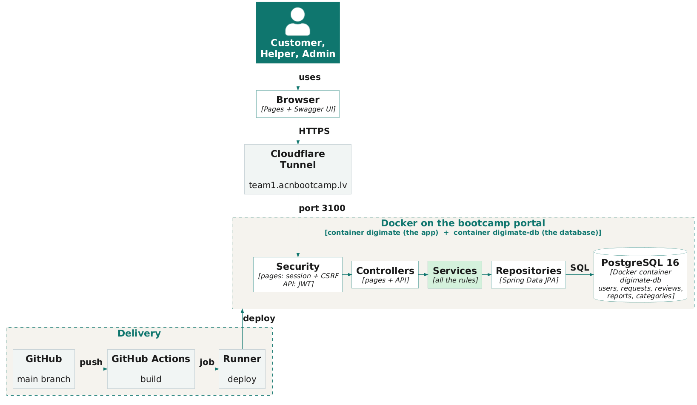

# Digimate
DigiMate connects people who need help with digital tasks, like online banking, government services or a new phone, with verified volunteer helpers, nearby or online.

**Live:** [LIVE_URL](https://team1.acnbootcamp.lv/)

## Features

- **Register and log in:** anyone can create an account; ticking “I also want to help others” applies to be a helper.
- **Ask for help:** customers create a request with a category, a preferred time, and in-person or online help. They can edit or cancel it while it is still open.
- **Privacy first:** the customer's and helper's name, phone and email are hidden until a helper accepts, and then only those two people see them. The admin never does.
- **Helper inbox:** verified helpers see open requests from other people, accept one and mark it as completed. If two helpers accept at the same moment, only the first one gets it.
- **Reviews:** after a request is completed, the customer rates the help from 1 to 5 with an optional comment.
- **Report a problem:** a customer can report the helper of an accepted or completed request; the admin reviews and dismisses the report or removes the helper.
- **Admin:** verifies new helpers and handles reports. Admin accounts cannot ask for help.
- **Safe input:** card numbers and personal ID numbers are blocked in free text.
- **Clear errors:** forms show errors next to each field, and missing or forbidden pages show friendly 404 and 403 pages.
- **REST API** for the same features, with JWT login and Swagger documentation.

## Tech stack

| Area | Technology |
|---|---|
| Language | Java 21 |
| Framework | Spring Boot 4.0 (Web MVC, Data JPA, Security, Validation) |
| Pages | Thymeleaf, Bootstrap 5.3 |
| API | REST, JWT (OAuth2 resource server), springdoc OpenAPI / Swagger UI |
| Database | PostgreSQL |
| Build | Maven (wrapper included) |
| Tests | JUnit 5, Mockito, Spring Boot test slices |
| Deployment | Docker, GitHub Actions |

## Architecture



- **Two ways in:** browser pages use form login, a session and CSRF protection; API clients use a stateless JWT. Each has its own security chain.
- **Controllers:** `controller.web` serves the Thymeleaf pages, `controller.api` the REST API.
- **One set of services:** both kinds of controllers call the same services, so every business rule exists only once.
- **Data:** Spring Data JPA repositories on PostgreSQL. Entities never leave the services; controllers get DTO records.
- **Privacy rule in one place:** `HelpRequestResponse.from` decides which contact details each viewer may see.

## Run locally

Requirements: Java 21 and PostgreSQL on `localhost:5432`.

1. Create the database user and the two databases. In pgAdmin, run each line **separately**:
```sql
   CREATE USER digimate WITH PASSWORD 'choose-a-password';
```
```sql
   CREATE DATABASE digimate OWNER digimate;
```
```sql
   CREATE DATABASE digimate_test OWNER digimate;
```

`OWNER digimate` is needed, otherwise the app cannot create its tables.

2. Set the environment variables. Never put their values in a file in the repository.
   | Variable | Value |
   |---|---|
   | `DB_USER` | `digimate` |
   | `DB_PASSWORD` | the password from step 1 |
   | `JWT_SECRET` | any random text, at least 32 characters |
   | `DEMO_PASSWORD` | optional: the password for the demo accounts, 8 to 72 characters |
   In IntelliJ: **Run → Edit Configurations → DigimateApplication → Environment variables**, for example
   `DB_USER=digimate;DB_PASSWORD=...;JWT_SECRET=...;DEMO_PASSWORD=...`
3. Start the app with the green Run button, or from the project root:
```sh
   ./mvnw spring-boot:run
```

On Windows PowerShell: `.\mvnw.cmd spring-boot:run`

4. Open http://localhost:8080 and log in. With `DEMO_PASSWORD` set, the demo accounts are created on the first start: see [docs/DEMO_DATA.md](docs/DEMO_DATA.md).

## API (Swagger)

With the app running, open http://localhost:8080/swagger-ui.html

1. Call `POST /api/auth/login` with an email and password, and copy the `token` from the response.
2. Click **Authorize**, paste the token, and confirm.
3. Every `/api/**` call now runs as that user.

## Live site and demo accounts

Live site: https://team1.acnbootcamp.lv

Use these accounts to try the application. The data on the site is demo data only.

| Role | Email | Password |
|---|---|---|
| **Admin** | `admin@digimate.test` | `0OpQby6c3zoHgt` |
| Customer | `customer1@digimate.test` | `0OpQby6c3zoHgt` |
| Customer | `customer2@digimate.test` | `0OpQby6c3zoHgt` |
| Verified helper | `helper@digimate.test` | `0OpQby6c3zoHgt` |

These passwords work on the live site only. On your own computer, see "Demo accounts on your own computer" below.

Log in as the admin to approve helpers, view users and handle reports at `/admin/helpers`.
All demo accounts share one password. The full list of accounts is in [docs/DEMO_DATA.md](docs/DEMO_DATA.md).

### Demo accounts on your own computer

On your own computer the demo accounts get the password that **you** choose. Set `DEMO_PASSWORD`
(8 to 72 characters, for example `Demo12345`) before you start the application.

IntelliJ: Run > Edit Configurations > DigimateApplication > Environment variables:

```
DEMO_PASSWORD=Demo12345
```

Terminal (PowerShell, for this window only):

```powershell
$env:DEMO_PASSWORD = "Demo12345"
```

The log then shows `Demo data ready: 7 users and 6 categories created`, and you can log in with the emails above.

- Without `DEMO_PASSWORD` (or with one shorter than 8 characters) only the categories are created, and there are no demo accounts.
- The accounts are created only the first time. If they already exist in your local database, a new password does not change them. Delete the rows first, for example `DELETE FROM users WHERE email LIKE '%@digimate.test';`, then restart.
- Do not commit your own passwords. The password in the table above is only for the live site.

## Running tests

Requirements: Java 21 and a running local PostgreSQL server on `localhost:5432`.
Create a dedicated, disposable database once per machine:

```sql
CREATE DATABASE digimate_test;
```

Set `DB_USER` and `DB_PASSWORD` in the terminal or IDE environment. The PostgreSQL
role must be able to connect to `digimate_test` and create tables in its schema.
Do not commit credentials or use a database containing data you want to keep.

Run the complete suite from the project root:

```sh
./mvnw test
```

On Windows, use `mvnw.cmd test`.

Database tests use `@ActiveProfiles("test")` to load
`src/test/resources/application-test.properties`. Hibernate uses `create-drop`,
so it creates tables when a test application context starts and drops them when
that context closes. The development database `digimate` is configured separately.
JPA slice tests also need `@AutoConfigureTestDatabase(replace = NONE)` to use
PostgreSQL. They roll back their data after each test.

`TestData` in `src/test/java/com/digimate/support` creates fresh, unsaved customer,
verified-helper, pending-helper, category and OPEN-request fixtures. Customize
fields with setters and save dependencies explicitly. Change fixture emails if
one test needs multiple users of the same kind, because emails must be unique.
`HelpRequestRepositoryTest` demonstrates saving and reloading a request.

For future tests, use the Spring Boot 4 packages:

- `org.springframework.boot.data.jpa.test.autoconfigure.DataJpaTest`
- `org.springframework.boot.jdbc.test.autoconfigure.AutoConfigureTestDatabase`
- `org.springframework.boot.webmvc.test.autoconfigure.WebMvcTest`
- `org.springframework.test.context.bean.override.mockito.MockitoBean`

The Boot 4 test starters in `pom.xml` already supply `spring-boot-starter-test`
and Spring Security test support transitively.

## Deployment

Every push to `main` deploys the app with the GitHub Actions workflow in `.github/workflows/docker.yml`. It runs on the team's self-hosted runner:

1. builds the JAR with Maven and a Docker image from the `Dockerfile`,
2. starts PostgreSQL in its own container the first time, with a volume so the data survives later deploys,
3. restarts the app container on port 3100 with the secrets from GitHub,
4. waits until the logs show `Started DigimateApplication`.
   The secrets `DB_PASSWORD`, `JWT_SECRET` and `DEMO_PASSWORD` are set in the repository settings, never in the code.
To start with an empty database, put `[reset-db]` in the commit message, or run the workflow manually with **reset_db** set to `true`.

## Documentation

- [Coding guide](docs/CODING_GUIDE.md)
- [Product backlog](docs/PRODUCT_BACKLOG.md)
- [Page contract](docs/PAGE_CONTRACT.md)
- [Demo data](docs/DEMO_DATA.md)
- [Test cases](docs/Testing%20Strategy/TEST_CASES.md)
- [Unit tests](docs/Testing%20Strategy/UNIT_TESTS.md)

## Team

- Hikmat
- Mykolas
- Anil
- Maksym
